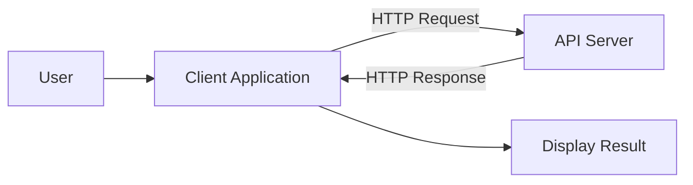
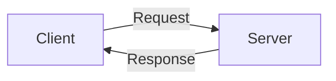
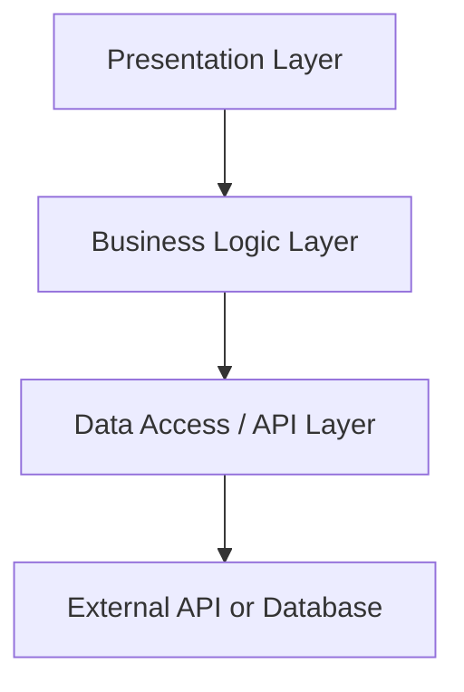
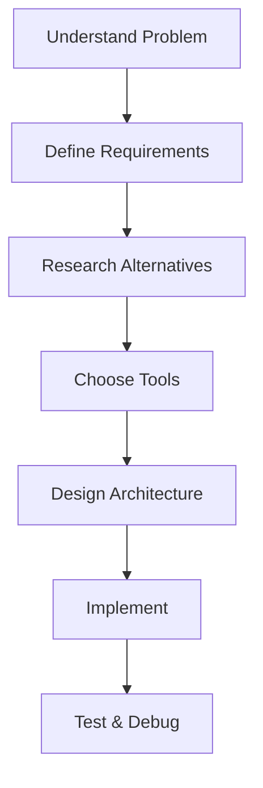

# 🌐 API Fundamentals — A Practical Learning Notebook

> **Learn the concept → Understand why → Compare alternatives → Try it yourself.**

A beginner-friendly guide to understanding APIs, HTTP methods, Python libraries, and basic software architectures.

This notebook is not tied to a specific project. It is designed to help you understand how APIs work and how to make good technical decisions when building applications.

---

## 📚 Table of Contents

1. [What is an API?](#1-what-is-an-api)
2. [API Access Types](#2-api-access-types)
3. [HTTP Methods](#3-http-methods)
4. [API Styles](#4-api-styles)
5. [JSON & API Responses](#5-json--api-responses)
6. [Python Libraries](#6-python-libraries)
7. [Software Architectures](#7-software-architectures)
8. [Planning an API Project](#8-planning-an-api-project)
9. [Hands-on Practice](#9-hands-on-practice)
10. [Knowledge Check](#10-knowledge-check)

---

## 1. What is an API?

**API (Application Programming Interface)** is a way for software components to communicate with each other.

For example:

- A weather application retrieves forecasts.
- A banking application retrieves account information.
- An e-commerce application processes orders.
- An AI application communicates with an external model.

### How does it work?



### Basic Terminology

| Concept | Description |
|---|---|
| Client | Application requesting information |
| Server | Application providing information |
| Endpoint | URL identifying an API operation |
| Request | Message sent to the API |
| Response | Message returned by the API |
| Authentication | Verifying the caller's identity |
| Authorization | Checking access permissions |

<details>
<summary>💡 Quick Question</summary>

**Is every API a REST API?**

No. APIs can use REST, SOAP, GraphQL, gRPC, or other approaches.

</details>

---

## 2. API Access Types

APIs can be classified based on **who is allowed to access them**.

### 🌍 Public APIs

Available to external developers under the provider's terms.

Examples:
- Weather APIs
- Public transportation APIs
- Open government data APIs

**Important:** Public does not always mean free or accessible without authentication.

A public API may still require an API Key.

### 🔒 Private APIs

Designed for internal use within an organization.

Examples:
- Employee management systems
- Internal inventory systems
- Company financial dashboards

Usually protected by authentication and access controls.

### 🤝 Partner APIs

Shared with specific external organizations.

Examples:
- Payment provider integrations
- Supplier inventory synchronization
- Shipping company integrations

Access usually requires approval or an agreement.

### Comparison

| Feature | Public | Private | Partner |
|---|---|---|---|
| Audience | External developers | Internal systems | Approved partners |
| Authentication | Sometimes required | Usually required | Usually required |
| Access restrictions | Provider-defined | Organization-defined | Agreement-based |
| Example | Weather data | Employee records | Supplier integration |

<details>
<summary>🧠 Test Yourself</summary>

**A public API requires an API Key. Is it still public?**

Yes. Public describes who can request access, not whether authentication is required.

</details>

---

## 3. HTTP Methods

HTTP methods describe the **action we want to perform**.

| Method | Purpose | Example |
|---|---|---|
| GET | Retrieve data | Get user information |
| POST | Submit or create data | Create an order |
| PUT | Replace a resource | Replace a profile |
| PATCH | Partially update a resource | Change a username |
| DELETE | Delete a resource | Remove an order |

### GET

Used to retrieve information.

```python
import requests

response = requests.get(
    "https://jsonplaceholder.typicode.com/posts/1",
    timeout=10
)

print(response.status_code)
print(response.json())
```

### POST

Used to submit data to a server.

```python
import requests

url = "https://jsonplaceholder.typicode.com/posts"

data = {
    "title": "Learning APIs",
    "body": "My first POST request",
    "userId": 1
}

response = requests.post(
    url,
    json=data,
    timeout=10
)

print(response.status_code)
print(response.json())
```

JSONPlaceholder is a demo API. Its POST endpoint simulates creating a resource without permanently storing it.

### PUT vs PATCH

**PUT:** Generally replaces the targeted resource.

**PATCH:** Updates selected parts of a resource.

### Safe vs Idempotent

These are two important HTTP concepts.

**Safe:** The request is intended not to modify application state.

**Idempotent:** Repeating the same request has the same intended effect as making it once.

GET is safe and idempotent.

PUT and DELETE are idempotent by HTTP semantics.

POST is not generally idempotent.

<details>
<summary>🧠 Quick Challenge</summary>

You want to update only a user's phone number.

Which method would you usually choose?

**Answer:** PATCH, assuming the API supports it.

</details>

---

## 4. API Styles

Different APIs use different communication styles.

| Type | Main Idea | Common Use |
|---|---|---|
| REST | Resource-oriented HTTP interactions | Web and mobile apps |
| SOAP | XML-based messaging protocol | Enterprise systems |
| GraphQL | Clients request specific fields | Complex application data |
| gRPC | Remote procedure calls | Internal services |
| WebSocket | Persistent two-way communication | Real-time applications |

### REST

Common in web applications.

Often uses:
- HTTP methods
- URLs identifying resources
- JSON responses
- Stateless requests

### SOAP

A messaging protocol based on XML.

Often used in enterprise integrations requiring formal service contracts.

### GraphQL

Allows clients to request specific fields.

Example:

```graphql
{
  user(id: "1") {
    name
    email
  }
}
```

### gRPC

A framework for calling methods on remote services.

Commonly uses Protocol Buffers and HTTP/2.

### WebSocket

Supports persistent, bidirectional communication.

Examples:
- Live chat
- Multiplayer games
- Real-time dashboards

WebSocket is a communication protocol, rather than the same kind of API design style as REST.

<details>
<summary>💡 Check Yourself</summary>

**Does REST always require JSON?**

No. REST APIs can use different representations, including JSON and XML.

</details>

---

## 5. JSON & API Responses

### What is JSON?

**JSON (JavaScript Object Notation)** is a lightweight data interchange format.

Example:

```json
{
  "name": "Ahmed",
  "age": 22,
  "skills": ["Python", "SQL", "APIs"]
}
```

### JSON Parsing in Python

The `requests` library provides:

```python
data = response.json()
```

This parses the JSON response into Python values.

| JSON Type | Python Type |
|---|---|
| Object | dict |
| Array | list |
| String | str |
| Number | int / float |
| Boolean | bool |
| null | None |

### Nested JSON

```python
data = {
    "user": {
        "name": "Ahmed",
        "skills": ["Python", "SQL"]
    }
}

name = data["user"]["name"]

first_skill = data["user"]["skills"][0]
```

### Dictionary Lookup

Python dictionaries use hash tables internally.

```python
user = {
    "name": "Ahmed",
    "age": 22
}

print(user.get("name"))
```

Lookup complexity is **O(1) on average**.

### Common HTTP Status Codes

| Code | Meaning |
|---|---|
| 200 | OK |
| 201 | Created |
| 400 | Bad Request |
| 401 | Unauthorized |
| 403 | Forbidden |
| 404 | Not Found |
| 429 | Too Many Requests |
| 500 | Internal Server Error |
| 503 | Service Unavailable |

A successful HTTP response does not guarantee that the JSON contains all the fields your application expects.

---

## 6. Python Libraries

Not every project requires the same libraries.

Choose libraries based on the problem you need to solve.

### Built-in Libraries

These are included with Python.

| Library | Purpose |
|---|---|
| os | Environment variables |
| json | JSON processing |
| pathlib | File paths |
| decimal | Decimal calculations |
| urllib.request | HTTP requests |
| unittest | Automated testing |
| logging | Application logging |

### Third-Party Libraries

These must usually be installed separately.

| Library | Purpose |
|---|---|
| requests | HTTP requests |
| httpx | Synchronous and asynchronous HTTP |
| python-dotenv | Loading `.env` files |
| pytest | Testing |
| FastAPI | Building APIs |
| Flask | Web applications and APIs |
| pydantic | Data validation |

### requests vs httpx vs urllib

| Feature | requests | httpx | urllib |
|---|---|---|---|
| Built into Python | No | No | Yes |
| Beginner friendly | Yes | Yes | Less convenient |
| Async support | No native async | Yes | No native async |
| HTTP Client | Yes | Yes | Yes |

**Recommendation:** Start with `requests` for simple synchronous API projects.

### Environment Variables

Store credentials outside your source code.

`.env` example:

```env
API_KEY=your_api_key_here
```

Python:

```python
import os
from dotenv import load_dotenv

load_dotenv()

api_key = os.getenv("API_KEY")
```

Never commit actual API keys to public repositories.

### Virtual Environment

Create an isolated Python environment.

```bash
python -m venv .venv
```

Activate on Windows PowerShell:

```powershell
.\.venv\Scripts\Activate.ps1
```

Install dependencies:

```bash
python -m pip install requests python-dotenv
```

Use `requirements.txt` to list the required packages.

---

## 7. Software Architectures

Architecture describes how we organize responsibilities and how different parts communicate.

### Architecture 1 — Simple Script

Suitable for small projects and assignments.

```text
project/
│
├── main.py
├── requirements.txt
├── .env.example
└── README.md
```

Advantages:
- Easy to understand
- Minimal setup
- Fast development

Limitation:
- Harder to maintain as complexity grows

### Architecture 2 — Client–Server



The client requests data or operations.

The server processes requests and returns responses.

### Architecture 3 — Layered Architecture



Example:

```text
project/
│
├── main.py
├── services.py
├── api_client.py
├── models.py
└── tests/
```

**Responsibilities:**

- `main.py`: User interaction
- `services.py`: Business logic
- `api_client.py`: External API communication
- `models.py`: Data classes
- `tests/`: Automated testing

### Architecture 4 — Three-Tier

Three logical tiers:

1. Presentation
2. Application Logic
3. Data Storage

Common in database-backed web applications.

### Architecture 5 — Microservices

Splits an application into independently deployable services.

Useful in some large systems, but introduces additional complexity.

**Important:** Do not choose a complex architecture unless the project needs it.

---

## 8. Planning an API Project

Before writing code, ask yourself:

### Step 1 — Understand the Problem

What does the user want to achieve?

### Step 2 — Identify Inputs and Outputs

What information is required?

What should the program return?

### Step 3 — Identify External Dependencies

Do you need:
- An external API?
- A database?
- Local files?
- Authentication?

### Step 4 — Compare Solutions

Consider:
- Simplicity
- Performance
- Cost
- Security
- Maintainability

### Step 5 — Read API Documentation

Check:
- Base URL
- Endpoints
- HTTP Methods
- Authentication
- Request parameters
- Response format
- Rate limits
- Error codes

### Step 6 — Design the Program

Break the application into smaller responsibilities.

Think about:
- Input
- Validation
- API Requests
- Data Parsing
- Processing
- Output

### Step 7 — Test

Consider both successful and failed cases.



---

## 9. Hands-on Practice

### Lab A — GET Request

Retrieve a blog post from JSONPlaceholder.

```python
import requests

url = "https://jsonplaceholder.typicode.com/posts/1"

try:
    response = requests.get(url, timeout=10)

    if response.status_code == 200:
        data = response.json()

        print("Title:", data.get("title"))
    else:
        print("HTTP Error:", response.status_code)

except requests.RequestException:
    print("Connection failed.")
```

**Your Task:**

Change the endpoint to `/posts/2`.

Compare the returned JSON.

### Lab B — POST Request

Send a JSON object.

```python
import requests

url = "https://jsonplaceholder.typicode.com/posts"

data = {
    "title": "Learning REST APIs",
    "body": "Practicing POST requests",
    "userId": 1
}

response = requests.post(
    url,
    json=data,
    timeout=10
)

print(response.status_code)
print(response.json())
```

This is a mock API. The created data is not permanently stored.

### Lab C — Design Challenge

Choose one application:

- Weather Application
- Library Management
- Student Attendance
- Task Management

Before writing Python, identify:

1. Inputs and outputs
2. API access type
3. HTTP methods
4. Required libraries
5. Architecture
6. Possible errors

---

## 10. Knowledge Check

### Q1. Can a Public API require authentication?

<details>
<summary>Reveal Answer</summary>

Yes. Public APIs can require API keys, authentication, and usage limits.

</details>

### Q2. What is the difference between GET and POST?

<details>
<summary>Reveal Answer</summary>

GET retrieves resources.

POST submits data for processing, often creating a resource.

</details>

### Q3. Does `response.json()` always return a dictionary?

<details>
<summary>Reveal Answer</summary>

No. JSON arrays become Python lists, and JSON can represent other values.

</details>

### Q4. What is the difference between PUT and PATCH?

<details>
<summary>Reveal Answer</summary>

PUT generally replaces a resource.

PATCH applies partial modifications.

</details>

### Q5. Do you need FastAPI to call an external API?

<details>
<summary>Reveal Answer</summary>

No. You can use an HTTP client such as `requests`.

FastAPI is used to build an API server.

</details>

### Q6. What does an HTTP 404 mean?

<details>
<summary>Reveal Answer</summary>

The requested resource was not found.

</details>

### Q7. Why do we use `.env`?

<details>
<summary>Reveal Answer</summary>

To keep configuration values and credentials separate from source code.

</details>

### Q8. Which architecture should you use for a small Python lab?

<details>
<summary>Reveal Answer</summary>

A simple script is usually sufficient.

Introduce layers when complexity increases.

</details>

---

## 📌 Quick Reference

| Question | Topic |
|---|---|
| Who can access the API? | Public / Private / Partner |
| How do I retrieve data? | GET |
| How do I submit data? | POST |
| How do I update data? | PUT / PATCH |
| How do I delete data? | DELETE |
| How do I read the response? | JSON Parsing |
| How do I handle failures? | Status Codes / Exceptions |
| How do I call APIs in Python? | requests / httpx |
| How do I build my own API? | FastAPI / Flask |
| How do I organize my code? | Software Architecture |

---

## 🔗 Useful Resources

- [MDN — HTTP Methods](https://developer.mozilla.org/en-US/docs/Web/HTTP/Reference/Methods)
- [MDN — HTTP Status Codes](https://developer.mozilla.org/en-US/docs/Web/HTTP/Reference/Status)
- [Python JSON Documentation](https://docs.python.org/3/library/json.html)
- [Python Requests Documentation](https://requests.readthedocs.io/)
- [FastAPI Documentation](https://fastapi.tiangolo.com/)
- [GraphQL Documentation](https://graphql.org/learn/)
- [gRPC Documentation](https://grpc.io/docs/)

---

**Learning Goal:** Understand the problem, choose the right tools, design a simple solution, and implement it confidently.

*Learn concepts, not just syntax.*
